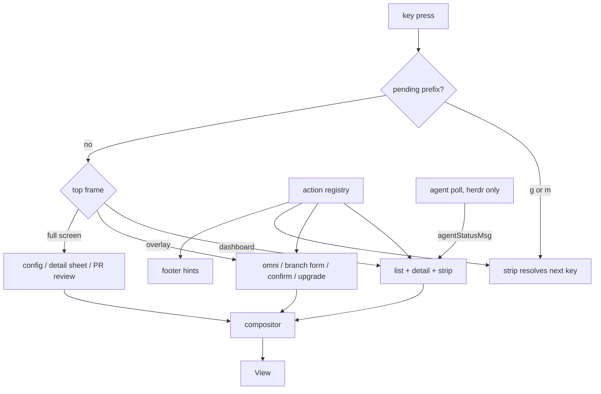

# Grove TUI Redesign: Design Spec

- **Status:** Draft for review, 2026-10-10
- **Supersedes:** the July 2026 plan `TUI_REDESIGN_IMPLEMENTATION_PLAN.md` on branch `feat/tui-rework`. Do not execute that plan.
- **Reference mockups:** `docs/redesign/*.html` (July 2026, sample data replaced). They show the visual language. Where a mockup and this spec disagree, this spec wins.
- **Traceability:** decisions here are `N1` to `N20`. July's decision ids (`D1` to `D15`) appear in parentheses where a decision carries one over.

---

## 1. Problems

From July, still true on `main`:

- **The TUI loses your place.** Every `esc` returns to the dashboard. Cursor and scroll are not restored.
- **It breaks below about 100 columns.** The narrow layout stacks the list and detail pane and wastes rows.
- **Overlays disturb the rows behind them** (issue #19). `centerOverlay` splices lines into the background.

New since July:

- **Agent status is hard to see and goes stale.**
  - Herdr reports agent state, but it shows as a small badge at the end of row line 2.
  - The TUI never refreshes on its own, so the badge is only as fresh as the last `r`.
- **New, fork, and switch-branch flows are a common complaint.**
  - They are confusing.
  - The box moves while you use it, and it disturbs the rows behind it.
- **Keys must suit recall limits and finger travel.** Recognition beats recall. The most frequent actions belong on or near the home row.

## 2. Goals and non-goals

| # | Goal |
|---|---|
| G1 | Never lose your place. `esc` goes back exactly one level. |
| G2 | Overlays never move or reflow what is behind them. |
| G3 | One row per worktree, readable from 44 to 120+ columns. |
| G4 | See and reach the agents that need you (herdr only). |
| G5 | One simple, fixed-frame form for new, copy, and switch-branch. |
| G6 | Recognition over recall: show options before asking for input; show names next to numbers; match synonyms. |
| G7 | Every existing dashboard key keeps working, except bare `u`. Frequent new actions sit on or near the home row. |
| G8 | Review a PR in the terminal with GitHub-style tabs. |

**Non-goals:**

- An agent-status source for tmux.
- PR comment authoring or approving.
- Choosing a different diff base for worktree diffs.
- An edit-in-place config editor.
- Self-update. Grove shows the install command and never runs it.

## 3. Glossary

Terms are used with one meaning each throughout.

| Term | Meaning |
|---|---|
| **worktree** | A git worktree managed by grove. One row on the dashboard. |
| **alias** | The worktree's short name. It drives the folder name (via `[naming] pattern`), the tmux session name, and the herdr workspace label. The CLI and the `name` sort mode call this "name". |
| **selection line** | Below 110 columns, the 1-line summary of the selected worktree that replaces the detail pane. |
| **slot** | A number `1` to `9` a worktree is pinned to. |
| **pin** | The link from a slot to a worktree. Stored per project. |
| **`agentAware`** | True when the resolved multiplexer backend is herdr. Gates every agent feature. |
| **attention** | An agent state that needs you: blocked first, then done. |
| **frame** | One entry on the view stack: a view plus its saved cursor and scroll. |
| **overlay** | A frame drawn on top of a dimmed, frozen copy of the frame below it. |
| **full-screen frame** | A frame that replaces the screen (config, detail sheet, PR review). |
| **strip** | A docked which-key bar above the footer, shown after a prefix key (`g`, `m`). Not a frame. |
| **omni** | The single search overlay opened with `space`. Finds worktrees, actions, PRs, and issues. |
| **action registry** | One table of every action: key, label, synonyms, scope, enabled check, handler. |
| **compositor** | The single code path that draws overlays and toasts over a base frame. |

## 4. Decisions

| Id | Decision | July | Status |
|---|---|---|---|
| N1 | View stack replaces the flat `activeView` enum | D1 | Kept |
| N2 | One compositor, uniform dim, no reflow | D2 | Kept |
| N3 | One-line rows with pin and agent lead columns; `v` toggles two-line | D3 | Changed |
| N4 | `list_secondary` config and `⎇` branch chip | D4 | Kept |
| N5 | Navigation: vim keys added, quick-switch becomes pins | D5 | Changed |
| N6 | Middle truncation and a fixed shed order | D6 | Kept, recomputed |
| N7 | One branch form with three modes replaces three wizards | D7 | Replaced |
| N8 | Config: full screen, one huh form per section | D8 | Changed |
| N9 | Upgrade: header badge, `g u`, bare `u` unbound | D9 | Kept |
| N10 | PR review view with four tabs | D10 | Kept |
| N11 | Prefix layers: only `g` (goto) and `m` (pin) | D11 | Changed |
| N12 | Omni on `space`; `?` is omni scoped to actions | D12 | Replaced |
| N13 | Existing keys unchanged; "fork" relabeled "copy worktree" | D13 | Dropped |
| N14 | Detail-pane focus at 110+ columns | D14 | Kept |
| N15 | Below 44 columns, a one-line guard | D15 | Kept |
| N16 | Agent triage: column, header summary, attention sort, `g a` | none | New |
| N17 | Herdr-only agent poll every 3s | none | New |
| N18 | Pins: `m` + digit, `1`-`9` switch | none | New |
| N19 | Action registry feeds footer, strips, and omni | none | New |
| N20 | Dependency bumps, including glamour v2 | none | New |
| N21 | Readability: focus label, 4.5:1 contrast, status never by color alone | none | New |
| N22 | Message history for warnings and errors | none | New |

---

## 5. Dashboard

### 5.1 Row anatomy (N3)

Columns, left to right:

| Column | Width | Content | Sheds? |
|---|---|---|---|
| Pin | 2 | Slot digit, or blank. Present only when the project has 1 or more pins. | Never |
| Agent | 2 | `!` blocked, `▸` working, `✓` done, blank otherwise. Present only when `agentAware`. | Never |
| Cursor | 2 | `❯` on the selected row | Never |
| Status dot | 2 | `●` current (green) or dirty (yellow), `✗` stale (red), `○` clean (muted) | Never |
| Alias | flex, floor 16 | The worktree's alias | Middle-truncates last |
| Branch chip | flex | `⎇ branch`, dim, per N4 | First |
| Counts | 11, right-aligned | `↑n ↓n ~n` | Collapses (5.2) |
| Age | 4 | Last-commit age (5.3) | Second |
| Tail | 4 | Session `⬢` active / `⬡` open; container `◆` running / `◇` stopped | Never |

- The cursor and status dot are separate columns. Selection never hides status.
- Words that sit in today's tail (`◆ blocked`, `⬡ herdr`, container short names) move out. Agent state is the lead glyph. Session and container words move to the detail pane.
- Agent glyphs differ in shape, not only color, so they read under `NO_COLOR`.
- All glyphs here are East Asian ambiguous width. Measure every column with `lipgloss.Width`, never `len`.

**@80x24, list only** (below 110 columns the detail pane becomes a selection line):

```
 grove · 5 worktrees · ! 1 blocked · ✓ 1 done · ⬍ name · ⭡0.12.0  1/5
 1 ! ❯ ● root            ⎇ main      ↓11 ~13   2d  ⬢ ◆
     ▸   ○ feature-auth              ↑2        2h  ⬡
 2       ○ fix-bug                             2h  ⬡
     ✓   ● testing                   ~1        5w  ⬡
         ○ refactor                            3d  ⬡

 root · ⎇ main · test commit for root
 j/k move · ⏎ switch · ␣ find · tab detail · / filter · g goto · ? help
```

**@44x24, narrowest tier:**

```
 grove · ! 1 · ✓ 1                  1/5
 1 ! ❯ ● root               ↓11  ⬢ ◆
     ▸   ○ feature-auth      ↑2  ⬡
 2       ○ fix-bug               ⬡
```

**@120x40:** the list keeps the 80-column row. A docked detail pane fills the rest.

### 5.2 Shed order (N6)

As width shrinks, apply these steps in order until the row fits:

1. Drop the branch chip. It sheds entirely before the alias would drop below 24 columns.
2. Drop the age.
3. Collapse counts to the single strongest signal: `↓` behind, then `~` dirty, then `↑` ahead.
4. Middle-truncate the alias, down to a 16-column floor.

- **Middle truncation** keeps a leading ticket id (`abc-1349`) and the last segment: `abc-1349-migrate-…-read`.
- Lead columns and the tail never shed.
- Below 44 columns the guard replaces the UI (5.6).

### 5.3 Age format

Ages follow git's relative dates (`git log --date=relative`, `date.c` `show_date_relative`): the same thresholds and rounding, written short in up to four columns, no "ago". A row then agrees with git and with the detail pane.

| Elapsed (git's rounding) | Shown |
|---|---|
| under 90 seconds | `45s` |
| under 90 minutes | `89m` |
| under 36 hours | `35h` |
| under 14 days | `13d` |
| under 70 days | `10w` |
| under 365 days | `11mo` |
| a year or more | `2y` (git adds months below 5 years; the row keeps the years) |

`m` is minutes and `mo` is months, as git spells them out.

Decided after Phase 4a hands-on testing: the first format floored each unit and disagreed with git's wording in the detail pane.

### 5.4 Density toggle

- `v` toggles a second line under each row with the commit message, indented to the alias column.
- Default is one line. The existing `compact_mode` pref keeps working: unset now means one line. A saved `false` keeps two lines.
- `tui.compact_list` in config keeps working the same way.

### 5.5 Header

Left to right, separated by `·`:

1. Project name
2. Worktree count
3. Triage summary, when `agentAware` and nonzero: `! 2 blocked · ✓ 1 done`
4. Sort indicator: `⬍ name`, with direction
5. Upgrade badge `⭡x.y.z`, when a newer version is cached (N9)
6. Cursor position `n/total`, right-aligned, tracking the filtered set

At narrow widths the count drops its word, the triage summary drops its words (`! 2 · ✓ 1`), and the project name truncates. The upgrade badge and `n/total` stay.

### 5.6 Width tiers (N1, N14, N15)

| Width | Layout |
|---|---|
| 110+ | List plus docked detail pane. `tab` or `l` focuses the detail pane: its border tints Primary, the list cursor dims, `j/k` scroll the pane, `h` or `esc` return. |
| 44 to 109 | List plus a selection line. `tab` or `l` push a full-screen detail sheet frame. |
| under 44 | One line: `grove needs ≥44 columns`. All state is kept. Widening restores it exactly. |

In the focused detail pane, `d` opens the PR review view for that worktree (same as `g d`).

### 5.7 Sort

- `o` cycles: **name → age → dirty → attention**. Attention appears only when `agentAware`.
- `O` reverses the current direction.
- **age** is last-commit age. It replaces today's "recent" (last accessed). This needs a raw commit timestamp on `WorktreeItem`; today only the formatted string exists.
- **attention** orders blocked, done, working, then the rest. Ties break by alias.
- The main worktree stays at the top in every mode, as today.

### 5.8 Branch chip (N4)

- Config `list_secondary`: `branch` (default), `dir`, or `off`. Config only, no runtime key.
- With `branch`, the chip shows only when the branch's last segment differs from the alias. This reuses the existing `last_segment` derivation.
- The worktree directory always appears in the detail pane's Git section.

### 5.9 Readability and focus (N21)

Added after hands-on testing of Phase 2.

- **Focus has a text label.** The focused detail pane's title reads `detail · focused`. The Primary border tint stays, but focus must read without color.
- **Contrast is at least 4.5:1** for every text and background pair, in the dark, light, and high-contrast themes. This includes text on the selected row. Testing measured dim text on the selected row at 3.4:1 (dark) and 3.9:1 (light).
- **Status never relies on color alone.** Every status keeps a distinct glyph, and the detail pane spells it out in words (`agent: blocked`, `working tree: dirty`).
- **Test:** a unit test computes the contrast of each theme's text tokens against `SurfaceBg` and `SelectionBg` with the existing contrast helpers, and fails below 4.5:1.

---

## 6. Keys

### 6.1 Rules for choosing keys

- **Keep what exists.** A key that works today keeps its meaning. The one exception is bare `u` (N9).
- **Frequent keys go on or near the home row.** `space` (thumb) is the cheapest key and goes to omni.
- **Show, don't make people recall.** Prefix keys open a strip listing every option. Pins show their digit in the gutter.
- **Use existing mnemonics.** `-` matches `cd -`. `m` matches vim marks. `n`/`p` mean next/previous.
- **One meaning per key per view.** View-local keys (PR view, form, config) may reuse a dashboard key.

### 6.2 Dashboard keys

**Unchanged:**

| Group | Keys |
|---|---|
| Move and switch | `j/k` and arrows, `⏎` switch, `U` switch and start containers |
| Worktree actions | `n` new, `d` delete, `R` rename, `f` copy worktree, `b` switch branch, `s` sync, `a` bulk delete |
| Views | `c` config, `p` PRs, `i` issues, `B` open PR in browser, `tab` detail pane |
| List | `o` sort, `r` refresh, `v` density, `/` filter |
| App | `?` help (now omni scoped to actions, section 9), `q` quit, `esc` back |

**Removed:** bare `u`. It is unbound and reserved. Never reassign it, or the `U` fat-finger hazard returns.

**Added:**

| Key | Action |
|---|---|
| `space` | Open omni (section 9) |
| `1`-`9` | Switch to the worktree pinned to that slot |
| `m` then `1`-`9` | Pin the selected worktree (section 8) |
| `gg` / `G` | Top / bottom of list |
| `ctrl+d` / `ctrl+u` | Half page down / up |
| `h` / `l` | Close / open the detail pane |
| `-` | Toggle to the last-active worktree. Its row shows a dim `↩`. |
| `O` | Reverse sort |
| `g` | Open the goto strip (6.3) |

**List paging keys.** The bubbles list binds its own keys by default:

| List action | Default keys |
|---|---|
| Previous page | `left`, `h`, `pgup`, `b`, `u` |
| Next page | `right`, `l`, `pgdown`, `f`, `d` |
| Top / bottom | `home`, `g` / `end`, `G` |

Phase 4 rebinds the list to `pgup`/`pgdown` and `home`/`end` only. That leaves `h l b u f d g G` to grove. A test asserts the list's bindings, as `newWorktreeList`'s quit guard does.

### 6.3 The `g` strip (N11)

```
 g goto
  g top of list   p pull requests   i issues   c config
  d diff          u upgrade grove   a agent needing you   esc close
```

- `g p`, `g i`, `g c` are aliases. Bare `p`, `i`, `c` still work.
- `g a` appears only when `agentAware`.
- `g u` is always present.
- The strip renders immediately with no debounce. A chain never waits for it: `gg` fires instantly.
- An unmapped key after `g` closes the strip and does nothing else.
- The strip is docked chrome. The list shrinks by its height and the selected row stays visible.

### 6.4 View-local keys

| View | Keys |
|---|---|
| PR browser | `j/k`, `⏎` open review, `n` new worktree from PR, `B` browser, type to filter, `esc` back |
| PR review | `1`-`4` tabs, `J/K` next/previous file, `t` file rail, `v` viewed, `z` fold, `⏎` context action, `B` browser, `a` all commits, `esc` back |
| Branch form | `tab` / `shift+tab` field, `ctrl+j` / `ctrl+k` or arrows suggestion, `⏎` act, `esc` back |
| Omni | `ctrl+j` / `ctrl+k` or arrows move, `⏎` run, `esc` back |
| Config | `ctrl+n` / `ctrl+p` next/previous section, `1`-`4` section when the focused field is not a text input, huh's own keys inside the form, `esc` save prompt |

**PR browser change:** today `⏎` on a PR row creates a worktree. It now opens the review view, and `n` creates the worktree. This is the only change to an existing key outside bare `u`.

---

## 7. Agent triage (N16, N17)

### 7.1 Gate

- `agentAware` is true when the resolved backend (`fetchContext.backend`) is herdr.
- It is computed once at startup and stored on the model. A later `r` or a config change does not flip it, so columns never appear or disappear mid-session. A backend change takes effect on the next launch.
- Every feature in this section is gated on it. Under tmux the dashboard matches the July row exactly.

### 7.2 States and display

| Herdr state | Lead glyph | Color token | In attention |
|---|---|---|---|
| blocked | `!` | Danger | Yes, first |
| done | `✓` | Success | Yes, second |
| working | `▸` | Warning | No |
| idle, unknown, unreported | blank | none | No |

- The detail pane's Status section adds a line: `agent: blocked`.
- The header shows the triage summary (5.5).

### 7.3 `g a`: jump to the next agent needing you

1. Move the cursor to the next **blocked** row below the cursor, wrapping around.
2. With no blocked rows, use **done** rows instead.
3. With neither, flash `no agents need you` in the footer and stay put.

If the target row is hidden by an active filter, clear the filter first.

### 7.4 Poll

- Runs only when `agentAware`. Interval: 3s, via `tea.Tick`.
- Each tick runs one `tea.Cmd` that calls the multiplexer's `List()`. No git, no config reload.
- The result updates only `TmuxStatus`, `SessionBackend`, and `AgentStatus` on existing items.
- **Generation counter:** a response older than the newest one is dropped, the same pattern as the PR fetch.
- **No overlap:** a tick is skipped while a poll is still in flight.
- **Cursor stability:** when attention sort is active, rows re-sort, and the cursor follows the same worktree path, not the same index.
- **Failure:** log a warning, keep the last known state, show nothing over the list.

---

## 8. Pins (N18)

### 8.1 Keys

| Input | Result |
|---|---|
| `m 3` | Pin the selected worktree to slot 3 |
| `m 3` when slot 3 already holds the selected worktree | Unpin it |
| `m 3` when slot 3 holds another worktree | Move the pin. The other worktree loses slot 3. |
| `m 0` | Unpin the selected worktree from any slot |
| `m esc` or `m` + any other key | Close the strip, change nothing |
| `3` | Switch to the worktree in slot 3 |
| `3` on an empty slot | Flash `slot 3 is empty · m 3 to pin` |

- A worktree holds at most one slot.
- `1`-`9` work while a filter is active, since slots do not depend on row position.
- Switching to the current worktree quits, as quick-switch does today.

### 8.2 The `m` strip

Pressing `m` shows every slot with its worktree, so the alias is visible next to the number:

```
 m pin to slot · root is selected
  1 root   2 fix-bug   3 ·   4 ·   5 ·   6 ·   7 ·   8 ·   9 ·   0 unpin   esc close
```

### 8.3 Storage and upkeep

- New field in `UIPrefs` (`internal/tui/prefs.go`): `Pins map[string]string`, slot digit to alias. Saved in `.grove/ui_prefs.json`.
- Renaming in the TUI updates the pin. Deleting in the TUI clears it.
- On load, pins whose alias no longer exists are pruned. **Prune only after a successful worktree fetch,** so a failed fetch never wipes pins.
- A rename or delete done in the CLI leaves a stale pin. It is pruned on the next TUI load.

---

## 9. Omni (N12)

### 9.1 Behavior

- `space` pushes the omni overlay frame. The selected worktree is remembered as the **target**.
- `?` pushes the same overlay scoped to actions. It replaces the help overlay.
- **Fixed frame, top-anchored** (same rule as the branch form, 10.4).

**Empty query:**

```
 ␣ ▏type a worktree, action, or #PR
  needs you   ! root (blocked) · ✓ testing (done)
  pinned      1 root · 2 fix-bug
  recent      feature-auth · refactor
```

- "needs you" appears only when `agentAware` and nonempty.
- "recent" uses last-accessed order from state.

**With a query (`ren`):**

```
 ␣ ▏ren
  actions     R rename worktree… · ⬍ sort by age
  worktrees   refactor · feature-rename-api
```

### 9.2 Sources

| Group | Searched text | Notes |
|---|---|---|
| Worktrees | alias, branch | From the current list items |
| Actions | label, synonyms, key | From the registry. Only actions enabled for the target. |
| PRs and issues | number, title, branch | **Cached data only.** Opening omni never calls `gh`, so it stays within the 500ms budget. |

### 9.3 Matching and results

- Fuzzy matching with `sahilm/fuzzy` (already in the module graph; promote it to a direct dependency).
- Highlight matched characters by rune offset, not byte offset.
- Each group shows at most 5 results. Group order: actions, worktrees, PRs and issues.
- `⏎` on a worktree switches to it. On an action, it runs on the target. On a PR, it pushes the review view.
- Matching runs in memory and must render each keystroke well within one frame for 200 items.

### 9.4 Synonyms

Each registry action carries plain-language synonyms, so a remembered nearby word works:

| Action | Example synonyms |
|---|---|
| copy worktree | fork, duplicate, clone |
| set upstream | tracking, remote |
| switch branch | checkout, change branch |
| sync | pull changes, bring over |
| delete | remove, trash |

---

## 10. Branch form (N7)

### 10.1 Why

Today's three flows (`overlay_create*.go`, `overlay_fork.go`, `overlay_checkout.go`) have these faults:

- Create has 6 internal steps behind a 3-dot stepper. It asks "existing or new?" before you type anything.
- "Fork" means two things: copying a worktree, and making a new branch from an existing one.
- Each flow has its own minimum height (15, 18, 20 lines). Taller content grows the box, and centering moves it.
- Width is 50% of the terminal, but the progress state hardcodes 60, so the box jumps on `⏎`.

### 10.2 One form, three modes

```
╭─ New worktree ───────────────────────────────────────╮
│ Branch ▏abc-1349-mig█                                │
│        abc-1349-migrate-reads      existing          │
│        abc-1349-migrate-writes     in use: abc-1349  │
│        + new "abc-1349-mig"                          │
│ Base   ▏main                                         │
│ Alias  ▏abc-1349                                     │
│        → grove-abc-1349 · session grove-abc-1349     │
│                                                      │
│ ✓ ready                                              │
│ ⏎ create · tab field · ctrl+j/k pick · esc back      │
╰──────────────────────────────────────────────────────╯
```

| Mode | Opened by | Title | Fields |
|---|---|---|---|
| New | `n`, `n` on a PR or issue row, omni | New worktree | Branch, Base, Alias |
| Copy | `f` | Copy `<alias>` | Branch, Alias, Changes |
| Switch | `b` | Switch branch of `<alias>` | Branch, Changes |

### 10.3 Fields

- **Branch.** Typing filters local and remote-only branches. Rows show `existing`, or `in use: <alias>` for branches checked out elsewhere. When the text matches no branch exactly, the last row offers `+ new "<text>"`.
  - Choosing a remote-only branch fetches it, as today.
  - Choosing an in-use branch shows `in use by <alias> · ⏎ switches there` in the status line.
  - Switch mode excludes in-use branches, as today.
- **Base.** Shown in New mode. Active only when the branch is new; otherwise it reads `n/a · existing branch`. Defaults to the default branch and accepts any branch, with the same suggestions. This keeps today's "new branch from an existing branch" ability.
- **Alias.** Derived from the branch's last segment until edited. Shows the folder name (from `[naming] pattern`) and the session label live. Conflicts appear in the status line.
- **Changes.** Shown only when the source worktree is dirty.
  - Copy mode: `move`, `copy`, or `leave`, as today.
  - Switch mode: `stash` only. `esc` is the cancel path, as today's "Cancel" option was.

From a PR or issue row, Branch and Alias are prefilled.

### 10.4 Fixed frame

- **Width:** 60% of the terminal, clamped to 56 to 76 columns. Computed on open and on resize only.
- **Height:** one constant for all modes and states. The suggestion list scrolls inside a fixed 4-row area.
- **Short terminals:** the frame never grows past the rows available. When it would, the title, status line, and key line stay pinned, and the fields scroll between them. Testing at 80x20 found today's create dialog clips its key line.
- **Position:** horizontally centered, **anchored at a fixed top row** under the header. Never vertically centered.
- **Progress:** after `⏎`, the activity log replaces the fields inside the same frame.
- **Errors** appear in the fixed status line, never as extra rows.
- `esc` during progress does nothing. The footer reads `creating…`.

### 10.5 Keys

| Key | Action |
|---|---|
| `tab` / `shift+tab` | Next / previous field. `tab` on Branch accepts the highlighted suggestion. |
| `ctrl+j` / `ctrl+k`, `↓` / `↑` | Move through suggestions |
| `⏎` | Act when valid. Otherwise focus the first invalid field. |
| `esc` | Pop back to where the form was opened, cursor restored |

### 10.6 Build notes

- Build on `bubbles/v2` `textinput`, which the current wizards already use. Not huh: it cannot hold a fixed height with a growing error footer, and it has no slot for the live `+ new` row.
- One state type with a mode field replaces `CreateState`, `ForkState`, and `CheckoutState`. Their `ReturnView` fields go away (the stack handles return).
- "Fork" is retired as a user-facing word. `f` stays; its label becomes "copy worktree".
- The split/fork prompt and its "don't show again" checkbox go away. See open item 4 for `default_branch_action`.

---

## 11. Config (N8)

- Pushed as a full-screen frame. The border and 60 to 80 column cap go away.
- **One huh form per section** (General, Behavior, Plugins, Protection). Grove owns section switching, because huh 2.0.3 does not expose the active group.
- **Header:** `grove ▸ settings`, then the section tabs `[1] general  [2] behavior  [3] plugins  [4] protection` with the active tab raised, then `● n unsaved` when dirty.
- **Section keys:** `ctrl+n` / `ctrl+p` move between sections from anywhere. `1`-`4` jump directly only when the focused field is not a text input, since digits must stay typeable.
- **Fixed height:** each form uses `WithHeight(h)`, `WithShowHelp(false)`, and `WithShowErrors(false)`. Grove draws the help line and `Form.Errors()` itself. Without this, huh's footer changes the height.
- **Field descriptions** come from the existing `ConfigField.Description`.
- **Dirty tracking fix:** compare each value to the value loaded from disk. Today it compares to the default (`syncConfigField` in `overlay_config.go`), so any non-default setting opens as dirty.
- **`esc`:** when dirty, the existing prompt (`⏎` save, `esc` discard). When clean, pop.

---

## 12. Upgrade (N9)

- **Header badge** `⭡x.y.z` (Warning color) when the update-check cache has a newer version. It replaces the footer badge.
- **`g u`** pushes an informational overlay: the available version and the platform's install command from `internal/updatecheck`, or `up to date`.
- It never runs an upgrade.
- Existing opt-outs (`GROVE_NO_UPDATE_NOTIFIER` and related) hide the badge. `g u` still opens and reports the cached state.

---

## 13. PR review view (N10)

### 13.1 Entry

- `⏎` on a PR row in the PR browser.
- `g d` on a worktree, or `d` in the focused detail pane: a diff of the worktree against its merge-base with the default branch, using local `git diff`. No `gh` needed.
- A PR result in omni.

### 13.2 Tabs

Tab strip anatomy: `[key] label count`, active tab raised, count dim.

| Tab | Content | Keys |
|---|---|---|
| `1` conversation | Read-only timeline: comments, review threads, check states | `⏎` on a thread jumps to its file and line in tab 4. `B` opens the browser. |
| `2` commits | Commit list | `⏎` scopes tab 4 to one commit (header shows the sha). `a` resets to all. |
| `3` checks | Check rollup | none extra |
| `4` files | Folder tree rail with `+/-` rollups, and a hunk pane | `J/K` file, `t` rail, `v` viewed, `z` fold removed runs, `⏎` open `$EDITOR` at file and line |

### 13.3 Data

- `gh pr view <n> --json comments,reviews,reviewThreads,statusCheckRollup,commits,files` and `gh pr diff <n>`, through the existing `runGH` path.
- A longer timeout profile than the current 15s for large diffs.
- Cache per PR, keyed on `UpdatedAt`.
- **PR browser list:** `p` shows the last cached list at once, marked stale, and refreshes in the background. Testing measured 2.06 to 2.28s before PRs appeared.
- Parse the diff once into files, hunks, and lines in `internal/git`. Render each hunk to a cached slice, so large diffs do not re-render per frame.
- Diff coloring with chroma's `diff` lexer.

### 13.4 Files tab details

- **Rail:** built on `viewport` with a path tree. Auto-hidden below 100 columns; `t` toggles it. (`bubbles/tree` exists in 2.2 but upstream pulled it from the README; revisit later.)
- **Viewed marks:** stored per PR in `ui_prefs.json`, as path to content hash. A file whose content changes loses its mark.
- **Editor:** `tea.ExecProcess` hands over the terminal and resumes the view unchanged. Use `+N file` by default; handle editors that need a different line flag.
- **Thread anchors:** key threads by path and line. If the anchor no longer matches, fall back to the thread's own `diffHunk`.

### 13.5 Degraded states

- `gh` missing or unauthenticated: one `gh required` panel for PR data. `g d` still works.
- A failure in one tab does not blank the others.

---

## 14. Empty, loading, and error states

- Every data surface has a labelled empty panel: no worktrees, no PRs, no issues, no search results.
- Loading shows a spinner. Failure shows a specific message.
- **Quit is never blocked** by a pending load.

**Message history (N22).** A toast disappears after 3 seconds, which is too short to read a warning in full.

- Every warning and error toast is also kept in a session message history (newest 50).
- The omni action `messages` (synonyms: `warnings`, `errors`, `log`) opens it as an overlay frame.
- No new top-level key.

---

## 15. Architecture

### 15.1 Units

| Unit | Owns | Depends on |
|---|---|---|
| View stack | Active frame; cursor and scroll per frame | none |
| Compositor | Drawing overlays and toasts over a dimmed, frozen base | View stack |
| Action registry | Every action's key, label, synonyms, scope, enabled check, handler | none |
| Strips | `g` and `m` which-key bars | Registry, pending-prefix field |
| Omni | Input, matcher, grouped results | Registry, list items, PR cache |
| Agent poll | Live session and agent fields | Multiplexer `List()` |
| Layout | Width tiers, row columns, shed order | none |
| Branch form | New, Copy, Switch modes | View stack, compositor |



### 15.2 View stack (N1)

- **Frame:** view id, list cursor, list scroll offset, and a pointer to that view's state.
- **Push** saves the current cursor and scroll. **Pop** restores them.
- `esc` pops exactly one frame. At the root it keeps today's behavior: clear the filter, then quit.
- Replace the flat `activeView` field and the roughly 44 hardcoded `esc → Dashboard` assignments across `model.go`, `overlay_*.go`, `view_*.go`, and `helpers.go`.
- Fold the `helpOverlay` and `updateOverlay` flags into the stack. One navigation system only.
- The model is passed by value through `Update`. Keep stack frames small: ints and pointers, no deep copies.
- Strips are not frames. One `pendingPrefix` field on the model holds `g` or `m`.

### 15.3 Compositor (N2)

- On pushing an overlay, freeze the last rendered base frame. Re-render it only on resize.
- **Dim:** `ansi.Strip` the frozen base, then render it in the muted text style. lipgloss has no built-in dim. Under `NO_COLOR` the dim is a no-op and the structure stays.
- Place layers with `lipgloss.NewCompositor`: base at Z0, overlay at Z1, toasts at Z2.
- **Anchoring:** input overlays (omni, branch form) are top-anchored. Small confirms and the upgrade overlay are centered. Both are fixed size.
- Replaces three paths: `overlayOnDashboard`, `compositeActiveOverlay`, and `compositeToastOnHeader`, plus `centerOverlay`.

### 15.4 Action registry (N19)

Shape (names illustrative):

```go
type Action struct {
	ID       string   // "worktree.rename"
	Key      string   // "R"
	Layer    string   // "", "g", or "m"
	Label    string   // "rename worktree"
	Synonyms []string // "move", "retitle"
	Scope    Scope    // which views offer it
	Enabled  func(m *Model) bool
	Run      func(m Model) (Model, tea.Cmd)
}
```

- Key dispatch, footer hints, both strips, omni, and `?` all read this table.
- A test asserts every binding in `keys.go` has a registry entry, so the surfaces cannot drift.

---

## 16. Dependencies (N20)

| Package | Pin | Target | Note |
|---|---|---|---|
| `charm.land/bubbletea/v2` | 2.0.2 | 2.0.10 | Renovate offers 2.1.0, released 2026-10-08. Prefer 2.0.10 until 2.1.0 has settled. |
| `charm.land/lipgloss/v2` | 2.0.1 | 2.0.6 | Renovate PR exists. Compositor API unchanged. |
| `charm.land/bubbles/v2` | 2.0.0 | 2.1.1 | Avoid 2.2.x: it rebinds list quit to `v` (upstream issue #1045), which would quit grove once `v` reaches the list. |
| `glamour` | 0.10.0 | `charm.land/glamour/v2` 2.0.1 | Runs on lipgloss v2 and removes the lipgloss v1 dependency. Module path change. v2 no longer probes the terminal, so grove handles color downsampling. |
| `x/exp/golden` | pseudo | v0.1.0 | First tagged release |
| `charm.land/huh/v2` | 2.0.3 | hold | No newer release |
| `sahilm/fuzzy` | indirect | direct | For omni |

- **Guard regardless of version:** disable the list's own quit binding (`KeyMap.Quit.SetEnabled(false)`), so a future bubbles bump cannot quit the app on `v`.
- July's unmerged bump commit `d4580f6` targets older versions. Do not cherry-pick it.

---

## 17. Phases

Each phase ships on its own and passes `make lint test`.

| # | Phase | Size | Needs | Delivers |
|---|---|---|---|---|
| 0 | Dependency bumps and list quit guard | S | none | N20 |
| 1 | Compositor and dim | M | 0 | N2, fixes #19 |
| 2 | View stack | XL | 1 | N1 |
| 3 | Branch form, three modes | L | 1, 2 | N7 |
| 4 | Dashboard: rows, pins, density, width tiers, focus, floor guard, sort, chip, readability, list paging keys | L | 2 | N3, N4, N5, N6, N14, N15, N18, N21 |
| 5 | Action registry, strips, omni, `?` as omni, message history | L | 4 | N11, N12, N13, N19, N22 |
| 6 | Agent triage and poll | M | 4, 5 | N16, N17 |
| 7 | Config and upgrade | M | 2, 5 | N8, N9 |
| 8 | PR review view, in sub-phases: data, diff model, files tab, viewed marks, other tabs, editor, `g d` | XL | 2, 5 | N10 |

- Phase 3 comes early because the branch flows are the most common complaint.
- Golden churn in phases 1, 2, 4 is expected. Review it with `make golden-diff`; do not bulk-accept.

---

## 18. Testing

Three tools, as defined in `docs/VISUAL_TESTING.md`:

- **Golden, NO_COLOR:** every static state at 44, 60, 80, 110, 120 columns.
- **Golden, themed:** color-only states. Dim, focus tint, agent glyph colors, dirty `●`, active tab. Use `RequireEqualEscape`.
- **teatest:** transitions. Push and pop, chords, omni, form modes, resize, poll.

**New harness pieces:** size presets for 44x24 and 110x40, a 40x24 guard preset, and builders `withPins`, `withAgents`, `withOmni(query)`, `withBranchForm(mode)`, `withFocus`, `withStrip(prefix)`.

**Required tests by area:**

| Area | Test |
|---|---|
| Stack | `esc` from every frame restores cursor and scroll; PR browser → review → back pops one level each |
| Compositor | With an overlay open, all base rows are still present and dimmed |
| Rows | One row per worktree at every width; tail never sheds; counts right-aligned in 11 columns; glyph width unit test |
| Shed | Each tier sheds in the order of 5.2 |
| Pins | Pin, move, unpin, `m 0`; rename keeps the pin; delete clears it; stale pin pruned only after a successful fetch |
| Strips | `g` then `g` in one batch reaches the top; unmapped key closes the strip |
| Omni | Empty state groups; synonym match (`copy` finds copy worktree); never calls `gh` |
| Branch form | **Width and height identical across all modes and states**, including errors and progress |
| Poll | Fake multiplexer changes states between ticks; cursor follows the same path under attention sort; stale generation dropped |
| Triage | `g a` order: blocked, then done, then the empty flash |
| Config | Height stable across sections; dirty count against loaded values |
| PR review | Golden per tab with mock data; editor round trip; viewed marks survive a restart; `gh` missing panel |
| Guard | 40x24 shows one line; widening restores state |

**Manual matrix before release:** `shift+tab`, `ctrl+d/u`, `ctrl+j/k`, `ctrl+n/p` under tmux, herdr, and one plain terminal. Record results in the release PR.

---

## 19. Open verification items

Each item is checked at the start of the phase named.

| # | Item | Phase | If it fails |
|---|---|---|---|
| 1 | huh `WithHeight` plus no footer gives an exact, stable height | 7 | Draw a fixed-height viewport around the form |
| 2 | `ctrl+j` arrives distinct from `⏎` under tmux, herdr, and a plain terminal | 3 | Arrows remain; drop the `ctrl+j/k` hint |
| 3 | Herdr `List()` latency fits a 3s poll | 6 | Raise the interval |
| 4 | `default_branch_action` config: the TUI no longer prompts. Confirm the CLI still uses it, and update the config docs. | 3 | Document it as CLI-only |
| 5 | Last-accessed data for omni's "recent" group exists in state | 5 | Drop the group |
| 6 | `bubbles/tree` stability for the file rail | 8 | Keep the custom rail |
| 7 | Screen-reader compatibility is unverified (separate from color and contrast checks) | 4 | Document the limits in `docs/TUI.md` |

---

## 20. Docs to update with the code

- `docs/TUI.md`: layout tiers, row anatomy, keys, pins, omni, branch form, config, sort modes. It also has existing drift: it lists an `alias` config field that does not exist and describes two-line rows as the default.
- `docs/CONFIGURATION_REFERENCE.md`: `list_secondary`, and `default_branch_action` scope.
- `docs/VISUAL_TESTING.md`: new size presets and builders.
- `docs/WIZARD_UX_RESEARCH.md`: a note that the branch form supersedes the stepped wizard.
- `CHANGELOG.md`: per release.
